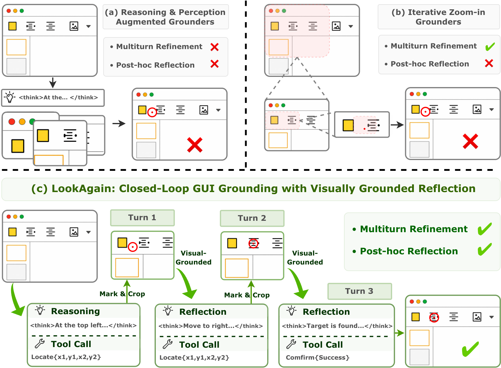

<div align="center">

<h2 class="papername"> LookAgain: Closed-Loop GUI Grounding with Visually Grounded Reflection</h2>
<div>
<div>
    <a href="https://scholar.google.com/citations?user=iMJYtvwAAAAJ" target="_blank">Renshan Zhang</a><sup>1</sup>,
    <a href="https://openreview.net/profile?id=~Haoyang_Meng1" target="_blank">Haoyang Meng</a><sup>2</sup>,
    <a href="https://openreview.net/profile?id=~Yixiao_He2" target="_blank">Yixiao He</a><sup>2</sup>,
    <a href="https://rshaojimmy.github.io/OrionLab/" target="_blank">Rui Shao</a><sup>1 3</sup>†,
    <a href="https://openreview.net/profile?id=~April_Hua_Liu1" target="_blank">April Hua Liu</a><sup>4</sup>,
    <a href="https://liqiangnie.github.io/index.html" target="_blank">Liqiang Nie</a><sup>1 3</sup>†
</div>

<sup>1</sup>Harbin Institute of Technology, Shenzhen<br>
<sup>2</sup>Beijing University of Post and Telecommunications<br>
<sup>3</sup>Shenzhen Loop Area Institute<br>
<sup>4</sup>Shanghai University of Finance and Economics<br>
†Corresponding author


[](https://arxiv.org/abs/2608.09723)
[](https://huggingface.co/renns/lookagain-8b)

</div>

</div>

<h3 align="center">
<strong>
✨If you find this work useful for your research, please kindly cite our paper and star our repo.✨
</strong>
</h3>

## Updates
- [08/2026] [arXiv paper](https://arxiv.org/abs/2608.09723) released.

## Introduction

This is the GitHub repository of _LookAgain: Closed-Loop GUI Grounding with Visually Grounded Reflection_. 
We introduce LookAgain, a novel closed-loop grounding paradigm that enables MLLM-based GUI agents to iteratively predict, inspect, and refine coordinates through visually grounded reflection. 
By combining reflective trajectory SFT with GRPO optimization, LookAgain achieves robust GUI grounding performance on various challenging scenarios.

<div align="center">

</div>

## Installation

1. Clone this repository and navigate to the folder
```bash
git clone lookagain.git
cd lookagain
```

2. Install the environment
```Shell
bash scripts/install_uv_env.sh
```


## Evaluation
### Download Benchmarks

Download the benchmark data from:

```text
osworld-g:       https://huggingface.co/datasets/MMInstruction/OSWorld-G
screenspot-pro:  https://huggingface.co/datasets/likaixin/ScreenSpot-Pro
ui-vision:       https://huggingface.co/datasets/ServiceNow/ui-vision
mmbench-gui:     https://huggingface.co/datasets/OpenGVLab/MMBench-GUI
venus-bench-gd:  https://huggingface.co/datasets/inclusionAI/VenusBench-GD
```

### Deploy Model

```bash
MODEL_PATH=/path/to/lookagain-8b bash scripts/start_server.sh
```

### OSWorld-G
```bash
# convert data format (for first run)
DATA_PATH=/path/to/osg bash scripts/osg/prepare_osworldg_inputs.sh
# run evaluation
bash scripts/osg/run_osworldg_eval.sh
```

### UI-Vision
```bash
# convert data format (for first run)
DATA_PATH=/path/to/uivision bash scripts/ui_vision/prepare_ui_vision_inputs.sh
# run evaluation
bash scripts/ui_vision/run_ui_vision_eval.sh
```

### Screenspot-Pro
```bash
# convert data format (for first run)
DATA_PATH=/path/to/ssp bash scripts/ssp/prepare_screenspot_pro_inputs.sh
# run evaluation
bash scripts/ssp/run_screenspot_pro_eval.sh
```

### MMBench-GUI-L2
```bash
# convert data format (for first run)
DATA_PATH=/path/to/mmb bash scripts/mmbench/prepare_mmbench_gui_inputs.sh
# run evaluation
bash scripts/mmbench/run_mmbench_gui_eval.sh
```

### VenusBench-GD
```bash
# convert data format (for first run)
DATA_PATH=/path/to/venus bash scripts/venus_bench_gd/prepare_venus_inputs.sh
DATA_PATH=/path/to/venus bash scripts/venus_bench_gd/prepare_venus_refusal_inputs.sh
# run evaluation
bash scripts/venus_bench_gd/run_venus_bench_gd_eval.sh
bash scripts/venus_bench_gd/run_venus_refusal_eval.sh
```


## Citation

If you find this work useful for your research, please kindly cite our paper:

```
@misc{zhang2026lookagain,
      title={LookAgain: Closed-Loop GUI Grounding with Visually Grounded Reflection}, 
      author={Renshan Zhang and Haoyang Meng and Yixiao He and Rui Shao and April Hua Liu and Liqiang Nie},
      year={2026},
      eprint={2608.09723},
      archivePrefix={arXiv},
      primaryClass={cs.CV},
      url={https://arxiv.org/abs/2608.09723}, 
}
```


